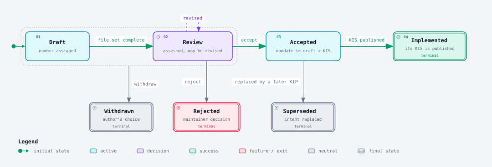
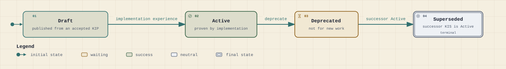

# Diagrams

This section is informative.

This repository explains itself in a maintained set of Archify diagrams. Each answers one question, is traced from named source files, and is listed with its staleness trigger and regeneration prompt in [`diagrams.toml`](diagrams.toml). The SVGs are plain light exports; they will be re-exported in the Knowledge Islands theme once that export is available.

## KIP status flow

Which statuses a KIP moves through, from `Draft` to its final outcome, and which transitions are allowed between them.

## KIS status flow

Which statuses a KIS moves through, from `Draft` to `Superseded`, and which transitions are allowed between them.

